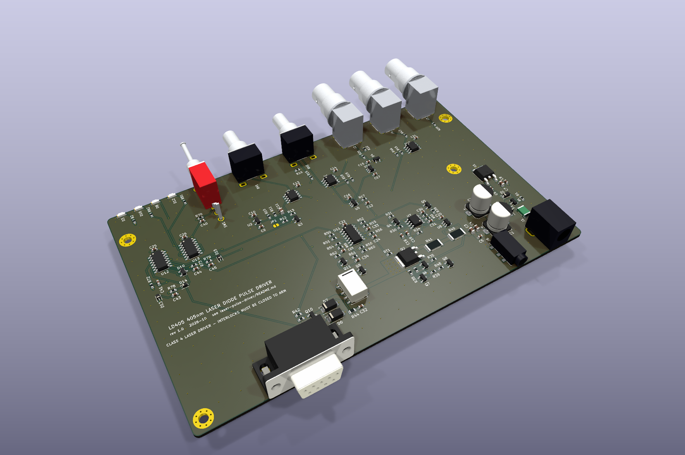
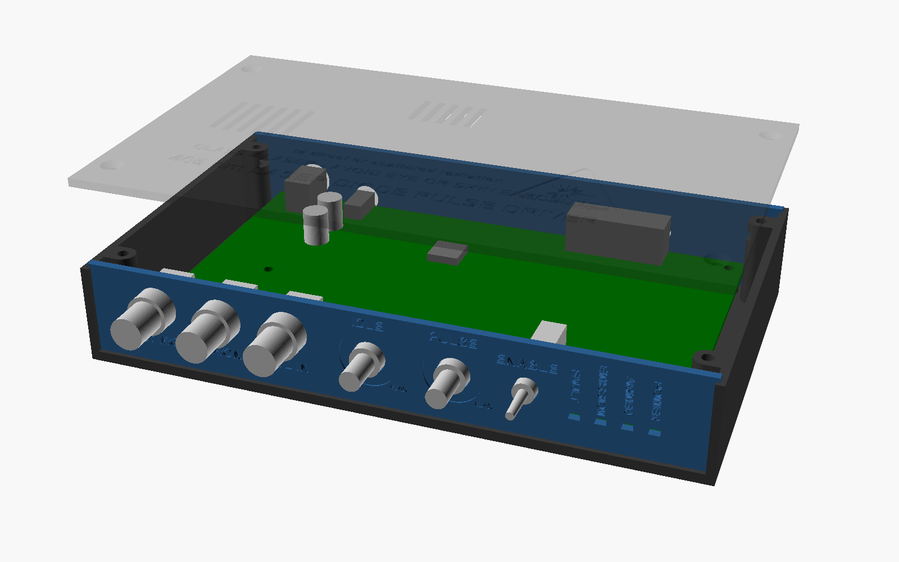

# LD405 – pulsed driver for a 405 nm (BDR-209) photo-ionisation laser diode

A bench-top, TTL-gated constant-current driver for a 405 nm laser diode used as
the second (ionising) step of a two-photon REMPI scheme during ablation loading.
An ARTIQ TTL line switches the diode between a low *idle* current (adjustable
5–104 mA: below threshold, or just above it for a dim alignment beam) and a
*pulse* current (adjustable 0–600 mA, or 0–700 mA with jumper JP1) for as long
as the TTL is high, e.g. 100 µs per ablation shot.



| | |
|---|---|
| Output | high-side current source, diode cathode at ground (Thorlabs "CG" DB9 pin-out) |
| Pulse current | 0–600 mA (PULSE knob), 0–700 mA with JP1 bridged; over-current trip at ~800 mA |
| Idle current | 5–104 mA (IDLE knob) whenever the TTL input is low or unconnected |
| Timing (simulated, 0.5–2.5 m cable) | ~0.7 µs delay, 4–6 µs 10–90 % rise, no overshoot, 1 % settled in ≤ 12 µs, ~7 µs fall |
| TTL input | BNC, 10 kΩ to ground, Schmitt trigger: high ≥ 2.0 V, low ≤ 0.5 V (≥ 0.4 V hysteresis); series 220 Ω + Schottky clamps to the rails. 3.3 V or 5 V TTL from ARTIQ (Kasli DIO-BNC / DIO-SMA) works directly |
| Monitors | I MON (measured diode current) and SET MON (pulse setpoint), both 1 V/A into high impedance (0.5 V/A into 50 Ω) |
| Compliance | ≥ 7 V across the diode at 700 mA (BDR-209 needs ~5–6 V) |
| Protection | output shorted by a relay and a MOSFET crowbar whenever disarmed; soft start (80 ms); over-current, open-circuit/compliance and over-temperature (85 °C) trips; two interlocks (3.5 mm jack + DB9 loop); fault latch that needs a deliberate re-arm; no auto-start after power-up |
| Supply | 9 V DC, ≥ 1.5 A (5.5/2.1 mm plug, centre positive); reverse-polarity, over-voltage and PTC fuse protection |
| Board / box | 160 × 100 mm 4-layer PCB (Eurocard), 3D-printed case 181 × 108 × 32 mm |

Design notes, simulation results and the protection logic are in
[docs/design-notes.md](docs/design-notes.md); the ARTIQ example is in
[artiq/ld405_pulse.py](artiq/ld405_pulse.py).

> **Class 4 laser.** A BDR-209 at these currents emits close to 1 W at 405 nm.
> Wear OD ≥ 4 eyewear rated for 405 nm whenever the diode is connected and
> armed, enclose the beam path, and use the interlock inputs (see *Safety*).

---

## 1. What to order, and where (UK)

Everything below ships to the UK. JLCPCB adds UK VAT at checkout for orders
up to £135; above that the courier (DHL/UPS) collects import VAT on delivery.

### 1.1 Assembled boards – JLCPCB (jlcpcb.com)

Upload these three files from [`hardware/fab/`](hardware/fab/):

| JLCPCB field | file |
|---|---|
| Gerber file (PCB order) | `ld405-driver_gerbers_jlcpcb.zip` |
| BOM (PCB Assembly step) | `ld405-driver_bom_jlcpcb.csv` |
| CPL / pick-and-place | `ld405-driver_cpl_jlcpcb.csv` |

PCB options (everything else at default):

* Layers **4**, dimensions 160 × 100 mm (read from the Gerbers), thickness **1.6 mm**,
  outer copper 1 oz, inner 0.5 oz, any colour, surface finish *LeadFree HASL* or *ENIG*.
* Via covering: *Tented* (the design assumes tented vias).
* Quantity: 5 boards, of which **2 assembled** (one spare).

PCB Assembly options:

* **Standard PCBA**, assemble **top side** only. The connectors, pots and the
  toggle switch are through-hole; JLCPCB hand-solders them as part of
  Standard PCBA. Confirm *"Parts placement"* so an engineer checks it.
* After the BOM/CPL upload JLCPCB shows a placement preview. Check that the
  pin-1/polarity marks agree for: U1–U14, Q1–Q11, diodes D1–D16, the LEDs
  (D3, D8, D12, D16 – lenses must face the board edge), C1/C2 (electrolytic)
  and K1. The CPL already contains the usual KiCad→JLC rotation offsets
  (SOT-23 +180°, SOIC +270°, electrolytics +180°); rotate anything that
  still looks wrong in the preview.
* All 69 BOM lines were in stock at JLCPCB/LCSC on 28 Oct 2026 (32 are
  "extended" parts, which carry JLCPCB's per-part setup fee). Expect roughly
  £200–300 for 2 assembled boards + 3 bare boards including shipping; the
  parts themselves are ~£25 per board.
* JP1 (700 mA range) is a solder jumper and is **left open** by JLCPCB.

### 1.2 Enclosure – 3D print (JLC3DP, any UK print service, or in-house)

STL files in [`enclosure/stl/`](enclosure/stl/), already in print orientation:

| file | qty | notes |
|---|---|---|
| `ld405_base.stl` | 1 | floor, side walls, PCB standoffs, lid posts |
| `ld405_lid.stl` | 1 | printed top-side down (engraved laser warning) |
| `ld405_front_panel.stl` | 1 | BNC/pot/switch/LED holes, engraved labels |
| `ld405_rear_panel.stl` | 1 | DB9, interlock jack and DC jack |

* **JLC3DP** (same JLCPCB account, "3D Printing" tab): *MJF PA12 nylon*
  (black) is strong, dimensionally accurate and needs no tuning. Add it to the
  PCB order to share shipping.
* UK alternatives: Protolabs (Telford, MJF/SLS), 3DPrintUK (London, SLS nylon),
  or the Craftcloud marketplace.
* In-house FDM: PETG or ASA, 0.2 mm layers, 4 perimeters, 30 % infill, no
  supports needed. Bed ≥ 185 × 110 mm.

The OpenSCAD source [`enclosure/ld405_enclosure.scad`](enclosure/ld405_enclosure.scad)
is generated from the board placement (`tools/gen_enclosure.py`), so the
holes follow the connectors if the layout changes.



### 1.3 Power supply and parts from RS Components / Farnell / CPC

| item | part | notes |
|---|---|---|
| 9 V DC supply | **Mean Well GST25A09-P1J** (9 V, 2.5 A, 5.5/2.1 mm plug, centre +) | desktop adapter with an IEC C14 inlet; any 9 V ≥ 1.5 A regulated supply with a 5.5/2.1 mm centre-positive plug works. RS, Farnell and CPC all stock it. |
| mains lead | UK plug → IEC C13 ("kettle lead"), 2 m | the 240 V socket within 2 m is enough |
| DB9 plug for the diode cable | DE-9 **male** solder-cup plug + metal hood with 4-40 jack screws | e.g. Amphenol/TE/Harting, any brand |
| diode cable | 2-core screened cable or a twisted pair, ≤ 2.5 m | keep the pair twisted to the diode |
| interlock plug | 3.5 mm **mono** jack plug | shorting plug, or wired to a door/enclosure interlock |
| knobs | 2 × knob for **6 mm D (flatted) shaft**, 15 mm shaft length | |
| screws | 4 × M3×12 pan head + 4 × M3 nut (PCB); 4 × M3×10 countersunk + 4 × M3 nut (lid) | stainless A2 |
| feet | 4 × self-adhesive rubber feet, ≤ 10 mm diameter | |

The BNC nuts and washers come with the connectors; the pots normally come with
an M9×0.75 nut and washer (buy two if not).

### 1.4 Laser diode – DTR's Laser Shop

* *900 mW 405 nm Blu-ray BDR-209 laser diode in copper module with leads*
  (optionally with the *G-2 glass lens* for collimation). DTR does not publish
  a datasheet; users report ~0.8–1 W at ~500–650 mA with ~5–6 V forward
  voltage, which this driver covers with margin. Calibrate the power yourself
  (section 4).
* Clamp the copper module in a heat-sinking holder. The diode case must not be
  connected to anything except through the DB9 cable.

### 1.5 Laser safety

Eyewear rated OD ≥ 4 at 405 nm for every person in the room (Thorlabs,
Laservision, Uvex and others sell suitable orange/amber filters), plus a beam
enclosure and beam dumps appropriate for a Class 4 source.

---

## 2. Assembly (about 30 minutes)

1. **Diode cable.** Solder the DE-9 male plug: **pin 8 → diode anode (+, red)**,
   **pin 3 → diode cathode (−, black)**, and a **wire link from pin 1 to pin 5**
   inside the hood (cable interlock: unplugging the cable trips the driver).
   Screen (if any) to pin 3 at the driver end only.
2. **Interlock plug.** Short tip to sleeve in a 3.5 mm mono plug, or wire it
   to normally-closed contacts of your enclosure/door interlock.
3. **Enclosure.** Push 4 × M3 nuts into the side slots at the tops of the
   lid posts. Fit the front panel onto the board (BNC nuts and washers on the
   outside; pot nuts on the outside, the pot's small anti-rotation lug sits in
   the pocket on the inside of the panel), and the rear panel over the DB9
   shell. Lower board + panels into the base so the panels drop into their
   grooves, then fix the board with 4 × M3×12 screws from below and nuts on top.
   Fit the knobs, put the lid on, 4 × M3×10 countersunk screws.

The ENABLE toggle is held by the board only (its bushing just passes through
the panel), so operate it gently.

---

## 3. Front and rear panel

| front | function |
|---|---|
| **TTL IN** (BNC) | high = pulse current, low/unconnected = idle current |
| **I MON** (BNC) | measured diode current, 1 V/A (high-Z scope input) |
| **SET MON** (BNC) | pulse setpoint, 1 V/A – shows what a pulse will deliver before you fire |
| **PULSE** | pulse current 0 → full scale (600 mA, or 700 mA with JP1) |
| **IDLE** | idle current 5 → 104 mA |
| **ENABLE** | arm / disarm, and reset after a fault (toggle off → on) |
| LEDs | POWER (green) · ARMED (yellow: relay open, current source enabled) · EMISSION (blue: diode current > ~18 mA, stretched so 100 µs pulses are visible) · FAULT (red, latched) |

| rear | |
|---|---|
| **LD OUT** (DE-9 female) | 8 = anode, 3 = cathode/ground, 1–5 = interlock loop (Thorlabs CG compatible) |
| **INTERLOCK** (3.5 mm) | must be closed (tip–sleeve shorted) to arm |
| **9V DC** | 9 V, ≥ 1.5 A, centre positive |

Arming sequence: after power-up the driver is always in FAULT (no automatic
start). With both interlocks closed, switch ENABLE off → on: the relay opens
the output short, ~20 ms later the current source starts and ramps to the idle
current over ~80 ms. Any fault (over-current, open diode/compliance,
over-temperature, interlock open) immediately shorts and crowbars the output
and latches FAULT until ENABLE is switched off and on again.

---

## 4. First power-up and calibration

1. **Without the diode**: plug in the DB9 cable with a **dummy load** instead
   of the diode – e.g. 5 × 1N5408 (or 1N4007) in series plus a 1 Ω 2 W
   resistor (≈ 5–6 V at 0.6 A, like the laser diode; pulsed use only) – and
   the interlock plug. Turn both knobs fully anticlockwise.
2. Power up: POWER on, FAULT on. ENABLE off → on: ARMED on, FAULT off.
3. Scope on I MON (1 V/A). Turn IDLE: the trace moves between ~5 and ~104 mV.
4. Drive TTL IN with 100 µs pulses at ≤ 10 Hz (section 5). Turn PULSE up:
   I MON shows the pulses; SET MON shows the level a pulse will reach.
   Check the pulse at full scale (≈ 600 mV on I MON) is flat with no ringing.
5. Optional 700 mA range: bridge solder jumper **JP1** (near U2/REF3030).
6. Disconnect one lead of the dummy load at the far end, leaving the DB9
   plugged in: FAULT must latch (open-circuit detection). Unplugging the DB9
   itself must also latch FAULT (cable interlock). Set both knobs to minimum,
   **disarm**, connect the diode, then arm.
7. Calibrate optical power with a thermal power meter: at a known duty cycle
   *D* the meter reads *P̄ ≈ P_peak · D* (e.g. 100 µs at 100 Hz, D = 1 %), or
   use a fast photodiode for the pulse shape. Increase PULSE slowly; read the
   current on I MON and note the knob position for your target peak power
   (~900 mW). Do not exceed the diode's current rating.

Duty cycle: the driver itself is fine at any duty cycle up to a few % at full
current (the pass transistor is heat-sunk into the board and the 85 °C
trip protects it); limit the duty cycle further for the diode's sake.

---

## 5. Using it from ARTIQ

Connect a Kasli TTL output (DIO-BNC/-SMA) to **TTL IN**. TTL high = pulse.
The current needs ~1 µs to start rising and ~10 µs to settle to 1 %, so open
the pulse ~10–15 µs before you need full power. [`artiq/ld405_pulse.py`](artiq/ld405_pulse.py)
fires the ablation trigger inside a 100 µs 405 nm pulse:

```python
with parallel:
    self.ttl_ld405.pulse(self.pulse_width)          # 405 nm REMPI 2nd step
    with sequential:
        delay(self.lead)                            # ~15 us head start
        self.ttl_ablation.pulse(self.ablation_width)
```

Tip: setting IDLE just above threshold gives a dim continuous 405 nm beam for
aligning onto the trap without firing pulses.

---

## 6. Repository layout

| path | contents |
|---|---|
| `hardware/` | KiCad 9 project: schematic, 4-layer PCB, custom footprints (`lib/ld405.pretty`) |
| `hardware/fab/` | manufacturing outputs (Gerbers, BOM, CPL), schematic + assembly PDFs, renders |
| `enclosure/` | OpenSCAD source, STL files, preview images |
| `artiq/` | ARTIQ experiment for ablation loading with the pulsed 405 nm laser |
| `sim/` | ngspice testbench and corner simulations (`get_models.sh` fetches the vendor models) |
| `docs/` | design notes, simulation plots and the design-review renders (`docs/review/`) |
| `tools/` | the generators: everything in `hardware/`, `hardware/fab/` and `enclosure/` is produced by these scripts |

Regenerating from source (KiCad 9 with its Python module, numpy, scipy, poppler,
matplotlib, gcc, OpenSCAD, ngspice):

```sh
cd tools
python3 gen_3d.py              # simple 3D models for parts without a KiCad model
python3 gen_fp.py              # custom footprints
python3 gen_sch.py             # schematic (ERC clean)
python3 gen_pcb.py --route     # placement, routing, zones, DRC-clean board
python3 export_fab.py          # Gerbers, drill, BOM, CPL, PDFs, renders
python3 gen_enclosure.py       # OpenSCAD model and STLs
python3 review.py              # review renders in docs/review/
cd ../sim && ./get_models.sh && python3 run_sims.py
```

`design.py` is the single source of truth for parts, values, LCSC numbers and
connections; `placement.py` holds the component positions.
