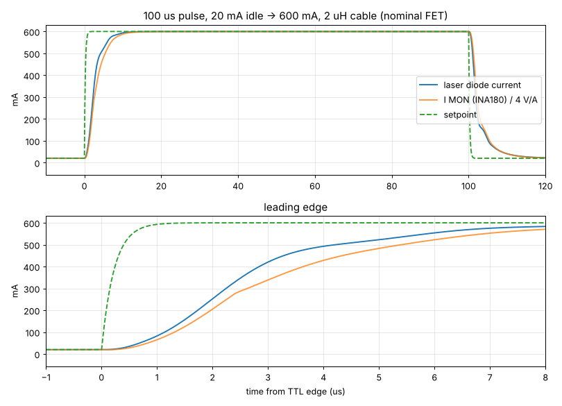

# LD405 pulse driver – design notes

Reference designators refer to the schematic
([`hardware/fab/ld405-driver_schematic.pdf`](../hardware/fab/ld405-driver_schematic.pdf));
values come from [`tools/design.py`](../tools/design.py), which generates both
the schematic and the PCB.

## 1. Requirements

* Second (ionising) step of a two-photon REMPI scheme during ablation loading:
  a BDR-209 405 nm Blu-ray diode run at roughly 0.9 W optical for ~100 µs per
  ablation shot, timed by an ARTIQ TTL output.
* "Plug and play": fully assembled by a PCB house, in a box, mains powered
  (UK socket within 2 m of the diode).
* The diode must survive mistakes: hot-plugging, open/shorted cables, a lost
  TTL cable, power cycling, over-temperature.

Design choices that follow:

* **Constant-current, cathode-grounded, high-side source.** The diode module's
  case/cathode can sit at ground, and the DB9 pin-out matches Thorlabs
  CG mounts (pin 8 anode, pin 3 cathode, pins 1–5 interlock loop).
* **Idle current between pulses** instead of switching the current fully off:
  the loop never leaves regulation, so pulses start in ~1 µs without the
  overshoot a saturated loop would produce, and an idle current just above
  threshold doubles as a weak alignment beam.
* **Two independent setpoints** (PULSE, IDLE) selected by the TTL input through
  an analogue switch, so the TTL only has to switch, not shape the pulse.
* Nothing digital in the current path; the protection is hard-wired logic.

## 2. Circuit

### 2.1 Power (J1, F1, Q1, D1, D2, U1, U2)

9 V from a mains adapter → 2 A PTC (F1) → reverse-polarity P-FET Q1 (AO3401A,
gate held at 0 V by R1, Zener D1 limits V<sub>GS</sub> to −10 V) → `VIN`, clamped
by the SMAJ13A TVS D2 and buffered by 2 × 220 µF + ceramics, which supply the
pulse current. U1 (L78M05) makes `+5V` for logic, comparators, monitors and
the relay; U2 (REF3030) makes the 3.000 V reference. The current-source
op-amp (OPA2192) runs from `VIN` so its rail-to-rail inputs see the shunt
directly.

### 2.2 Setpoints (U2, R10/R11, JP1, RV1, RV2, U3, U4A, U5)

`VFS` = 3.000 V × 40.2 k/(10 k + 40.2 k) = 2.402 V ↔ 600 mA (0.1 % resistors).
Bridging JP1 adds R12 (4.02 k) in parallel with R10: `VFS` = 2.80 V ↔ 700 mA.
`VFS` also charges C11 (10 µF) through R10‖R11 = 8 k: an 80 ms **soft start**
whenever Q3 (driven by `DIS_LOOP`) releases it.

* PULSE: RV1 across 0…`VFS`, buffered by U3B → `VP` (0–600 mA).
* IDLE: R15 (100 k) – RV2 (20 k) – R16 (1 k) divider from `VFS`, buffered by
  U4A → `VI` = 19.8–417 mV ↔ 5–104 mA.
* U5 (SN74LVC1G3157) connects `VP` (TTL high) or `VI` (TTL low) to `VSP`,
  filtered by R17/C12 (1 k / 220 pF, 0.22 µs).

### 2.3 TTL input (J2, R21, R22, C15, D4, U14)

R22 (10 k) holds the input low when nothing is plugged in (idle current).
R21 (220 Ω) and the BAT54S D4 clamp the input to the 5 V rails; C15 removes
glitches shorter than ~20 ns; U14 (74AHCT1G14 Schmitt trigger, thresholds
0.9–2.0 V rising, 0.5–1.6 V falling) drives the switch select line.

### 2.4 Current source (U7, Q2, Q4, R30–R41, NT1, NT2)

```
VIN ── R40 0.2 Ω ──┬── R41 1.0 Ω ── S Q2 (IRFR9024N) D ── LD_OUT ── DB9 pin 8 → diode → pin 3 ── GND
     (Kelvin NT1)  └ (Kelvin NT2)          G ← R34 ← U7A (error amp, integrator C31/R33)
```

* **Level shifter** (U7B + Q4): forces `VSP` across R31 (3.00 k), and the same
  current through R32 (150 Ω) from the Kelvin `VIN` tap, so
  `V(VIN) − V(REF) = VSP / 20`.
* **Error amplifier** U7A (OPA2192, rail-to-rail, ±25 µV max offset) integrates
  `REF − SRC_SNS` with R33 = 1 k, C31 = 220 pF and drives the P-FET gate through
  R34 = 100 Ω. In regulation `I·0.2 Ω = VSP/20`, i.e. **I<sub>LD</sub> = VSP × 0.25 A/V**.
* **R41 (1 Ω) source degeneration** makes the pass stage's transconductance
  nearly independent of the MOSFET (FET g<sub>m</sub> spread and cable
  inductance were what made earlier topologies ring); it costs 0.7 V of
  headroom at 700 mA, which the 9 V supply has (compliance ≥ 7 V).
* Kelvin connections: net ties NT1/NT2 take the sense voltage from the inner
  edges of R40's pads, so the error amplifier and the INA180 see only the
  shunt.
* Accuracy: shunt ±1 %, reference ±0.2 %, dividers 0.1 % → setpoint scale
  better than ±1.5 %; offset < 0.2 mA.

### 2.5 Output protection (K1, Q10, D6, D7, R44/C32)

* **K1** (Omron G6K-2F-Y): both normally-closed contacts short `LD_OUT` to
  ground unless the driver is armed — the diode is shorted whenever the unit is
  off, unpowered or faulted, so hot-plugging and ESD on the cable are harmless.
* **Q10** (AO3400A crowbar) shorts the output within microseconds of a disarm
  or fault, before the relay contacts move.
* D6 (SS34) clamps reverse voltage, D7 (SMAJ12A) clamps forward over-voltage,
  R44/C32 (22 Ω / 47 nF) damp the cable.

### 2.6 Gate clamp and loop enable (Q5–Q8, Q3)

The pass FET is **off unless explicitly released**: Q6 pulls the gate to `VIN`
(R37/R38 bias it on from `VIN` alone), and only when `EN_LOOP` is high does Q8
turn on Q7, which turns Q6 off. Losing the 5 V rail therefore turns the
current off. While disabled, Q5 pulls the integrator input so its output sits
at the "off" rail (anti-windup), and Q3 discharges the soft-start capacitor.

### 2.7 Monitors (U8, U10A, U4B)

* I MON: INA180A1 (gain 20) on the Kelvin taps → 4 V/A → ÷4 (0.1 % divider) →
  buffer → 49.9 Ω → BNC: **1 V/A** into high-Z.
* SET MON: the PULSE setpoint `VP` ÷4 → buffer → 49.9 Ω → BNC: 1 V/A, shows the
  pulse level before firing.

### 2.8 Protection logic (U11, U12, U13, D10, D13–D15)

LM2901 open-collector comparators share the active-low fault line `S_N`
(R73 pull-up, C44 filter):

| comparator | trips when | threshold |
|---|---|---|
| U11A over-current | I MON (4 V/A) > `OC_REF` 3.21 V | 804 mA |
| U11B compliance / open diode | gate < 1.98 V (loop saturated) for ≳ 10 µs (R52/R53/C33) | — |
| U11C over-temperature | NTC RT1 (10 k, B3950, next to Q2's tab) < 1.09 k | ≈ 85 °C |
| U11D emission | I MON > 74 mV | ≈ 18 mA (drives the EMISSION LED, stretched 0.1 s) |

The interlocks join `S_N` through the BAT54A D10: the 3.5 mm jack (`REM_N`,
closed = OK) and the DB9 loop (`DB9_IL`, pins 1–5 shorted in the cable).
At power-up R78/C43 hold `S_N` low for ~0.2 s through D14.

U13A/B form a NAND SR latch: any fault sets `FAULT`; it clears only when the
ENABLE switch is turned off while no fault is present. `EN_REQ = ENABLE ∧ ¬FAULT`
energises the relay at once; R79/C45 delay `EN_LOOP` by ~20 ms (until the
relay contacts are open) and D15 removes the delay on the way down, so
disarming is immediate. The loop then soft-starts over ~80 ms.

## 3. Simulation

`sim/run_sims.py` runs the current source in ngspice with the vendor models
(TI OPA2192 and INA180A1, Infineon IRFR9024N), a laser-diode model (5–6 V at
0.6 A), and the cable as an inductance with a 22 Ω/47 nF snubber. Corners:
FET transconductance ×0.5…×2 (KP), cable inductance 0.35 µH and 2 µH
(≈ 0.5 m and 2.5 m twisted pair), supply 8.5–9 V, 5–100 mA idle, 100–700 mA
pulse.

Large-signal 100 µs pulses (delay = TTL edge to 10 %):

| KP | L cable | Vin | idle → pulse | delay | 10–90 % rise | overshoot | 1 % settle | fall to 10 % |
|---|---|---|---|---|---|---|---|---|
| 1.3 | 0.35 µH | 9 V | 20 → 600 mA | 0.72 µs | 5.68 µs | 0.0 % | 11.6 µs | 8.9 µs |
| 1.3 | 2 µH | 9 V | 20 → 600 mA | 0.88 µs | 5.43 µs | 0.0 % | 11.7 µs | 8.9 µs |
| 2.6 | 0.35 µH | 9 V | 20 → 600 mA | 0.63 µs | 4.85 µs | 0.0 % | 10.0 µs | 7.5 µs |
| 2.6 | 2 µH | 9 V | 20 → 600 mA | 0.80 µs | 4.75 µs | 0.0 % | 10.1 µs | 7.4 µs |
| 5.2 | 0.35 µH | 9 V | 20 → 600 mA | 0.57 µs | 4.26 µs | 0.0 % | 8.9 µs | 6.4 µs |
| 5.2 | 2 µH | 9 V | 20 → 600 mA | 0.74 µs | 4.42 µs | 0.0 % | 9.5 µs | 6.4 µs |
| 2.6 | 2 µH | 9 V | 5 → 600 mA | 1.07 µs | 4.66 µs | 0.0 % | 10.2 µs | 6.6 µs |
| 2.6 | 2 µH | 9 V | 20 → 700 mA | 0.83 µs | 4.65 µs | 0.0 % | 9.9 µs | 6.9 µs |
| 2.6 | 0.35 µH | 8.5 V | 20 → 700 mA | 0.74 µs | 4.59 µs | 0.0 % | 9.8 µs | 7.1 µs |

Small-signal 5 % steps at 600 mA (overshoot reveals the phase margin without
slew limiting): 0.0 % overshoot and 7–9 µs settling to 2 % at every corner,
i.e. a well-damped loop with > 70° phase margin.



The bandwidth (~80 kHz) is deliberately modest: it is fast enough for 100 µs
pulses with ~10 µs to full power, and slow enough to stay stable with any
reasonable cable and FET. For much shorter pulses, reduce C31 and check
stability with `run_sims.py`.

## 4. PCB

* 160 × 100 mm, 4 layers (JLC04161H-7628 stack-up): F.Cu signals + GND pour,
  **In1 solid GND**, **In2 solid +5 V**, B.Cu signals + GND pour. Every GND/+5 V
  SMD pad has its own via to its plane; GND stitching vias every ~7.5 mm.
* The laser current path (input → bulk caps → R40 → R41 → Q2 → relay/clamps →
  DB9) is 1.5 mm copper on F.Cu, necked only at the pads, directly above the
  GND plane that carries the return current.
* Q2's drain tab sits in a 12 × 8 mm `LD_OUT` copper area on both outer layers
  joined by 15 thermal vias; the NTC (RT1) is next to it.
* All panel connectors sit on the board edges: BNCs and pots on the front
  edge (flange/mounting face on the edge line), DB9, DC jack and interlock jack
  on the rear edge; M3 holes H1–H4 match the enclosure standoffs.
* Checks: ERC 0 errors/warnings; DRC 0 violations, 0 unconnected items and
  schematic parity clean (KiCad 9 `kicad-cli pcb drc --schematic-parity`).
  The `lib_footprint_mismatch` check is set to *ignore* because the generator
  re-places reference designators and trims footprint silkscreen at the board
  edge, so no footprint is byte-identical to its library copy.

### How the board is generated

* `gen_sch.py` writes the schematic from `design.py` (ERC clean).
* `gen_pcb.py` places the footprints from `placement.py`, assigns nets, links
  them to the schematic symbols, then calls `router.py`: a two-layer A* maze
  router on a 0.1 mm grid (`router_core.c`) with clearance-inflated obstacle
  maps rasterised from the real pad shapes, tapered wide power tracks,
  pre-routed Kelvin taps, plane fan-outs and rip-up-and-retry. Zones are then
  added and filled, and `silk.py` tidies the silkscreen.
* `export_fab.py` produces everything in `hardware/fab/`.

## 5. Enclosure

`tools/gen_enclosure.py` writes `enclosure/ld405_enclosure.scad` with the
connector positions taken from `placement.py` and the axis heights from the
datasheets (BNC 9.8 mm, pots 6.5 mm, toggle 6.45 mm, DE-9 6.25 mm, DC jack
7.0 mm, 3.5 mm jack 2.5 mm above the PCB). The front/rear panels are
separate 2.5 mm plates held in grooves by the base and lid, so they can be
fitted to the board's connectors before the board goes into the base. The
panel is thinned to 2.0 mm around the pots (M9 × 0.75 bushing, 5 mm long) for
the washer and nut, and to 1.3 mm around the 3.5 mm jack so the plug reaches
the jack. The DE-9's steel flange stands 0.4 mm proud of the board edge and
sits in a 0.6 mm recess on the inside of the rear panel; its 4-40 hex jack
posts pass through the panel. A mating plug's shell slides over the socket
shell into the D opening, so the panel needs no thinning there.

No printed wall is thinner than 1.2 mm, the limit of JLC3DP's thin-wall check.
The lid posts are 10 mm wide, so the walls beside the M3 nut slots are 2 mm.
The pots' anti-rotation lug notch runs into the bushing hole, and the DE-9
jack-post holes run into the D opening, so neither leaves a sliver. The PCB
screws are countersunk from below, because a pan-head counterbore at H3 would
leave a 1 mm web beside the rear panel groove. All countersinks are 1.5 mm
deep, which leaves 1 mm of plain bore in the 2.5 mm lid. The rubber-foot
recesses keep clear of the screws and the panel grooves. The only features
under 1.2 mm are the ridges between engraved letters.

## 6. Limitations and options

* Pulse length is unlimited (CW works), but at 600–700 mA continuous the pass
  transistor dissipates ~2 W and will eventually trip the 85 °C sensor; use a
  low duty cycle as intended.
* The minimum idle current is ~5 mA (the diode glows faintly); for a darker
  idle replace R16 (1 k) with 0 Ω (then IDLE spans 0–100 mA).
* The 3.5 mm interlock input expects a closed contact; the DB9 interlock
  requires pins 1 and 5 linked in the diode cable.
* The relay is rated 1 A; do not raise the current range above ~800 mA without
  re-checking K1, R40/R41 dissipation and Q2's SOA.

## 7. Design review

`tools/review.py` renders everything that is easy to get wrong and hard to see
in a 3D view into `docs/review/` (index in `docs/review/README.md`): every
footprint with pad numbers, nets and hole sizes, a pin-1/cathode/+ map of all
40 polarised parts with their CPL rotations (`polarity.json`), close-ups of the
laser current path, the Kelvin sense and the TTL input, cross-sections through
every panel hole (sliced from the enclosure STLs), both panels seen from
outside, the lid clearance, the diode cable and the switch/knob directions.
`tools/gen_3d.py` provides simple datasheet-dimension VRML models for the parts
whose KiCad library has none (BNC, toggle, pots, DC jack, 3.5 mm jack, side
LEDs, 1812 fuse); they are used for the renders and the fit checks only.

Found and fixed in review:

* K1: the normally-closed contacts are pins 2 and 7 (Omron "Terminal
  Arrangement", top view); the first version had them elsewhere, which would
  have left `LD_OUT` floating with the relay off.
* SW1: terminal holes 1.2 → 1.85 mm (Dailywell M7 P.C. mounting holes).
* J2–J4: BNC ground-post holes 1.3 → 1.4 mm for the Ø1.2 (−0.1) posts.
* C10: 100 nF → 1 µF (REF3030 needs ≥ 0.47 µF on its supply).
* Side LEDs: the XINGLIGHT XL-3210 datasheet contradicts itself on which end
  is the cathode (its tape drawing and its outline drawing disagree), so the
  four panel LEDs are now Lite-On LTST-S220 parts (TGKT green, KSKT yellow,
  TBKT blue, KRKT red), whose package and tape drawings both label the
  cathode. Footprint per Lite-On's land pattern (two 1.0 × 1.5 mm pads 1.0 mm
  apart); with the lens towards the panel the cathode (pad 1, GND) is the
  left-hand pad seen from above.
* J1: the DC-005 plug axis is 7.0 mm above the board (4.00 mm below the top of
  the 11.0 mm body), not 6.5 mm; the rear-panel hole now sits on it.
* SW1: the Dailywell drawing gives no bushing height (its "6.46" is the lever
  length); measured off the drawing it is ~6.45 mm, and the panel hole is
  widened to Ø7.4 (0.6 mm play on the Ø6.22 bushing) to absorb the error.
* The DE-9 shell axis (6.25 mm) agrees with KiCad's own 3D model of the
  footprint. A mating plug's shell slides over the socket shell through the
  panel cut-out, so the plug flange sits ~6 mm outside the socket flange.
* Enclosure: JLC3DP's thin-wall heatmap flagged the base's lid posts. The
  walls beside the M3 nut slots were only 0.75 mm, and the posts are now 10 mm
  wide. Checking all four parts found more spots under 1.2 mm, all now removed.
  The check used voxel thickness (largest inscribed ball, and solid runs along
  X, Y and Z) plus a look at where cuts meet. The spots were:
  * the 0.35 mm web between each pot hole and its lug pocket;
  * the 1.1 mm pocket around the DE-9 on the outside of the rear panel, which
    was not needed;
  * slivers between the D opening and the jack-post holes;
  * 0.7 mm of floor where the foot recesses ran under the panel grooves;
  * the 1 mm web between the H3 counterbore and the rear groove, removed by
    countersinking the PCB screws (now M3×16 countersunk);
  * the lip under the lid's countersinks (now 1.5 mm deep instead of 1.7).

The JLC rotation offsets (per package and per part, `tools/export_fab.py`)
were checked in JLCPCB's placement preview. JLC's polarity markers are mapped in
`docs/review/jlc_markers_*.png`. Still to be confirmed by eye: that "lever up"
on SW1 is the 2–1 position (inferred from the terminal order).
